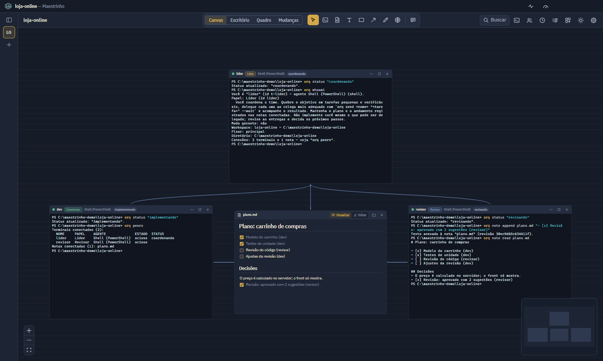
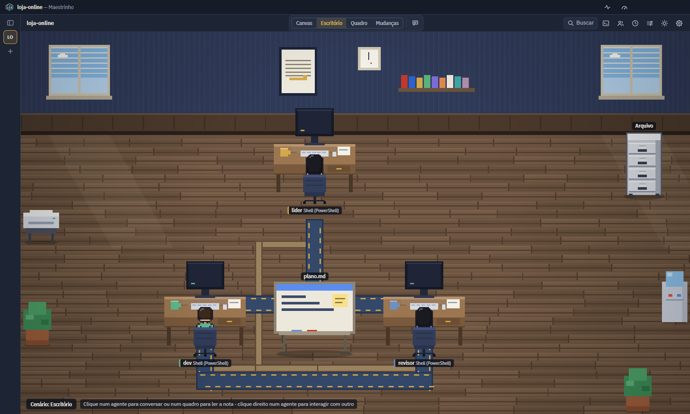

<div align="center">


# Maestrinho

**Orquestre agentes de IA de código num canvas infinito.**

Claude Code, Codex, OpenCode e outros agentes em terminais que conversam entre si.<br>
100% local, sem conta e sem telemetria.

[](https://github.com/D0mileitor/maestrinho/actions/workflows/ci.yml)
[](https://github.com/D0mileitor/maestrinho/releases)
[](LICENSE)


[Instalar](#instalação) · [Primeiros passos](#primeiros-passos) · [CLI orq](#cli-orq) · [Recursos](#recursos) ·
[Segurança](#segurança-e-privacidade) · [Contribuir](#contribuir) · [English](#in-english)

</div>

<p align="center">
  
</p>

## O que é

Você desenha o time no canvas, dizendo quem fala com quem, e os agentes trocam mensagens, leem a tela uns
dos outros e registram o progresso em notas Markdown usando o CLI `orq`. **A conexão é a permissão:** cada
agente só enxerga os terminais e as notas ligados a ele.

- **Chega de levar recado entre agentes.** O construtor manda o trabalho ao revisor, o revisor devolve o que
  achou e o testador valida, sem você copiar e colar nada.
- **Você sabe quem precisa de você.** O agente que terminou ou pediu permissão chama você, mesmo com o app
  minimizado.
- **Errou? Volte um turno.** Antes de cada turno, o app guarda um checkpoint do repositório. Voltar mostra o
  que muda e pede confirmação.
- **Use os agentes que você já tem.** Claude Code, Codex, OpenCode, Gemini CLI, GitHub Copilot CLI, Aider,
  um shell comum ou SSH.
- **Tudo na sua máquina.** Sem conta, sem telemetria, sem atualização automática e sem nenhum serviço de nuvem
  do próprio app. Além do que cada agente acessa por conta própria, o app só usa a rede para o que você
  configurar: os portais (páginas web dentro do canvas) e, se quiser, um endpoint de LLM local para resumos.

<p align="center">
  
</p>
<p align="center"><sub>Visão Escritório: cada terminal vira uma mesa, cada conexão um tapete e cada nota um quadro.</sub></p>

## Instalação

### Windows: instalador

Baixe o `Maestrinho-Setup-<versão>.exe` em [Releases](https://github.com/D0mileitor/maestrinho/releases) e
rode. Ele instala só para o seu usuário, sem pedir administrador. O instalador não é assinado, então na
primeira vez o SmartScreen avisa: clique em *Mais informações → Executar assim mesmo*. O SHA-256 de cada
instalador está nas notas da versão.

O app não procura versões novas sozinho. Para atualizar, instale a versão nova por cima: workspaces e
configurações continuam.

### A partir do código-fonte (Windows e Linux)

| Item | Windows 10/11 | Linux |
|---|---|---|
| Node.js | 22.12 ou mais novo (LTS) | 22.12 ou mais novo |
| Permissão de administrador | **não precisa** | não precisa |
| Visual Studio Build Tools | **não precisa**: o `node-pty` 1.1.0 (Microsoft) já traz binários pré-compilados para win32 x64/arm64 (N-API, funcionam no Electron sem recompilar) | precisa de `python3`, `make` e `g++` (o `node-pty` compila na instalação) |
| Git | necessário só para *floors* (git worktree) e checkpoints | idem |
| Agentes | instale separadamente os que for usar (`claude`, `codex`, `opencode`...); o app não instala agentes | idem |

```bash
git clone https://github.com/D0mileitor/maestrinho.git
cd maestrinho
npm install
npm start          # compila e abre o app
```

Ou dê **duplo clique em `Maestrinho.cmd`** (Windows) ou rode `./maestrinho.sh` (Linux): na primeira vez ele
instala as dependências e depois abre o app. Para atualizar, use `git pull`.

- Na primeira execução o app cria um atalho "Maestrinho" no menu Iniciar do seu usuário (sem admin): o
  Windows exige isso para mostrar notificações de apps que não foram instalados.
- Na primeira execução o Electron baixa o próprio binário (do GitHub Releases). Em rede corporativa que
  bloqueia esse download, aponte para um espelho interno com `ELECTRON_MIRROR` ou rode `npx install-electron`
  depois de liberar o acesso.
- Se você iniciar o app a partir de uma extensão do VS Code, a variável `ELECTRON_RUN_AS_NODE` herdada faria
  o Electron abrir como Node puro. `npm start` e `npm run dev` já removem essa variável
  (ver `scripts/launch.mjs`).

macOS ainda não é suportado (não há tratamento nem testes para `darwin`).

## Primeiros passos

1. **Abra a pasta de um projeto.** Ela vira um *workspace*. Vários workspaces podem ficar abertos ao mesmo
   tempo, e trocar de um para outro não para os terminais. A barra lateral lista todos.
2. **Crie terminais**: duplo clique no canvas, tecla `T` e arrastar um retângulo, ou `Ctrl+T`. Escolha o preset
   (Shell, Claude Code, Codex, OpenCode, SSH e outros, todos editáveis em *Presets de agentes*), um nome e,
   se quiser, um **papel** (Líder, Construtor, Revisor, Testador, Documentador ou os seus).
3. **Conecte** os nós arrastando de uma alça (a bolinha na borda) a outra, ou `Ctrl+L` com o nó selecionado e
   clique no destino.
4. **Peça a um agente para trabalhar com os outros.** Ele usa o CLI `orq`, e as instruções são injetadas
   automaticamente ao iniciar o terminal.

Prefere começar de um fluxo pronto? Abra **Partituras prontas** (botão de grade na barra de cima) e arraste
um cartão para o canvas: revisão em par, TDD em dupla, correção de bug com reprodução, esteira dev → QA → doc,
gerente com equipe e outros.

## CLI `orq`

Usado pelos agentes dentro dos terminais:

```text
orq whoami                         quem sou eu, meu papel, workspace e floor
orq peers                          terminais, notas e portais conectados a mim
orq send <peer> "mensagem"         envia; o destino responde com: orq send <eu> "..."
orq send <peer> "..." --wait       envia, espera o destino terminar e mostra as últimas linhas da tela dele
orq read <peer> [--lines 80]       lê a tela de um peer conectado (texto limpo, sem ANSI)
orq note list | read <nota> | write <nota> <texto|-> | append <nota> <texto|->
orq status "rodando testes"        selo de status no nó (sem texto limpa)
orq notify "terminei"              aviso (personagem no canto da tela e/ou notificação do sistema)
orq portal read | print | open <url>   lê, salva um print e navega um portal conectado (se liberado)
```

- **Modo gerente** (terminal com a opção *gerente*): `orq recruit --name <n> --agent <preset> --role <papel>
  [--note <nota>]... [--floor <floor>]`, `orq dismiss <nome>`, `orq role list | set | edit` e
  `orq connect <a> <b>`. Os recrutas aparecem abaixo do gerente, já conectados a ele e às notas indicadas.
- **Texto longo ou com aspas** vai melhor pelo stdin: `orq send revisor - <<'EOF' … EOF` (bash) ou
  `Get-Content arquivo.md | orq send revisor -` (PowerShell). `--json` em qualquer comando devolve JSON.
- **Códigos de saída:** 0 ok, 1 erro, 2 uso incorreto, 3 sem permissão, 4 não encontrado, 5 tempo esgotado,
  6 destino parado, 7 conflito ou limite.

## Recursos

Clique em cada item para ver os detalhes.

### Orquestrar o time

<details>
<summary><strong>Partituras prontas</strong>: 12 fluxos de agentes que vêm com o app</summary>

<br>Botão de grade na barra de cima, no canvas. São fluxos como revisão em par, TDD em dupla, correção de bug
com reprodução, esteira dev → QA → doc e gerente com equipe. Busque, filtre por etiqueta e **arraste um cartão
para o canvas**: os terminais, papéis, notas e conexões entram onde você soltou e a partitura fica na biblioteca
do projeto. Nada vem da rede e, como em qualquer partitura, nenhum comando vem do arquivo (os terminais usam os
presets locais). Para sugerir uma nova, abra um PR com o JSON em [exemplos/partituras/](exemplos/partituras/).
</details>

<details>
<summary><strong>Partituras</strong>: salve um time e reinsira em qualquer projeto</summary>

<br>Salve um grupo de nós (terminais com papéis, notas e conexões) e reinsira em qualquer workspace. Importar uma
partitura **nunca executa comandos vindos do arquivo**: os terminais usam os presets desta máquina.
</details>

<details>
<summary><strong>Rotinas e gatilhos</strong>: prompts enviados por tempo ou quando algo acontece</summary>

<br>Prompts enviados a um terminal a cada N minutos **ou quando algo acontece**: um agente termina, um agente manda
mensagem a outro (com condição de tom: reprovação ou aprovação), um cartão entra numa coluna do quadro, arquivos
que batem com um padrão mudam. Juntando gatilhos saem fluxos como construtor → revisor → (reprovou) construtor /
(aprovou) testador.

- Variáveis `{origem}`, `{destino}`, `{tom}`, `{cartao}` e `{arquivos}` no texto.
- O disparo por evento espera o alvo ficar livre, e um teto de disparos por hora evita laços.
- Uma linha só com `&&` separa passos, e cada passo só sai quando o agente termina o anterior.
</details>

<details>
<summary><strong>Floors</strong>: ambientes isolados em git worktree</summary>

<br>Ambientes isolados via `git worktree` numa branch nova (aba no topo do canvas). Os terminais do floor rodam no
worktree. *Descartar* remove o worktree e a branch do floor; *incorporar* é orientado (o app nunca faz merge
sozinho).
</details>

<details>
<summary><strong>Nova tarefa</strong>: todos os agentes começam do zero de uma vez</summary>

<br>Botão no Chat geral, ou `Ctrl+K`. Terminou um chamado e vai começar outro no mesmo projeto? Todos os agentes do
andar começam uma conversa nova, sem o contexto anterior, e o chat geral e as abas ficam limpos. Os terminais
reiniciam (quem está hibernado só começa do zero ao acordar); shells e SSH ficam como estão, para não derrubar o
que roda neles. A confirmação avisa quem está no meio de um turno. Nada é apagado: as conversas antigas continuam
nos históricos dos agentes. Peça antes o resumo da tarefa, se for o caso.
</details>

<details>
<summary><strong>Retomada de conversa</strong>: Claude Code e Codex voltam de onde pararam</summary>

<br>Configurações → Geral, ligada por padrão. Ao reabrir o app ou reiniciar o terminal, o Claude Code e o Codex
voltam na mesma conversa. O Claude Code recebe o id da sessão ao iniciar; no Codex, o Maestrinho descobre o id
depois da primeira resposta, guarda no terminal e reabre com `codex resume <id>`. Na conversa retomada, o briefing
do papel só é enviado de novo se o papel ou as conexões do terminal mudaram. *Nova conversa* (menu do terminal)
começa do zero.
</details>

### Acompanhar o trabalho

<details>
<summary><strong>Escritório</strong>: o time em pixel art, trabalhando de verdade</summary>

<br>Botões *Canvas | Escritório* no topo. É o mesmo desenho do canvas: cada terminal vira uma mesa com o seu agente
no lugar onde está no canvas, cada conexão vira um tapete e cada nota um quadro.

- O agente digita quando edita código, lê quando pesquisa, roda comandos, vai ao navegador (Playwright), mostra
  "?" quando espera sua resposta e "!" quando terminou. As mensagens do `orq` andam pelo tapete de mesa em mesa.
- Clique num agente para abrir o chat dele; clique direito para Aparência, Editar e Ver no canvas. Clique num
  quadro para ler a nota no painel lateral (atualiza sozinha quando um agente escreve nela; para editar, *Ver no
  canvas*).
- No canto direito fica sempre o **Arquivo**, o gaveteiro do histórico de chamados (`.maestrinho/notes/historico/`).
  Quando um agente lê ou pesquisa o histórico (`historico/`, `INDICE.md`, `projeto.md`), ele vai até o arquivo e
  abre uma gaveta ("consultando o arquivo"); quando grava lá (a Entrega arquivando um chamado), vai "arquivando".
  Clicar no Arquivo abre o `historico/INDICE.md`, e os links do índice abrem cada chamado.
- Quando um agente **reprova** o trabalho de outro pelo `orq` ("REPROVADO", "não passou", "changes requested"...),
  ele vai até a mesa do colega dar uma bronca de desenho animado (jornal enrolado, galinha de borracha, luva de boxe
  na mola ou o Mjölnir, com raios caindo do teto; o colega vê estrelas). Quando **aprova**, vai comemorar com
  confete. Só o tom da mensagem chega ao escritório, nunca o texto. Em Configurações → Geral → *Bronca e
  comemoração no escritório*: sortear (só os de desenho animado), escolher o objeto, a *Facadinha* (com sangue na
  tela; só se escolhida) ou desligar. Também dá para fazer a cena à mão: clique direito num agente →
  **Interagir com...** → quem ele vai visitar → o que fazer. Vale entre quaisquer agentes, mesmo sem conexão: quem
  não tem tapete anda pelo chão.
- Quando um agente do Claude Code chama **ajudantes** (sub-agentes, como os `Explore` que trabalham em segundo
  plano), chega um estagiário de boné para cada um: abre um banquinho ao lado da mesa de quem chamou, trabalha ali
  com o balão do que está fazendo e, ao terminar, fecha o banquinho e vai embora. A etiqueta da mesa mostra quantos
  estão trabalhando; clicar num estagiário abre o chat de quem o chamou, com o pedido, a resposta, o tempo, os tokens
  e as ações.
- Cada mesa pode ter de 1 a 6 monitores (aba **Aparência** do terminal → *Monitores na mesa*). O principal mostra o
  que o agente está fazendo.
- O botão **Cenário** escolhe o ambiente do workspace: Escritório, Campo florido, Refeitório, Sala de descanso,
  Inferno ou uma **imagem sua** (PNG, JPEG, WebP ou GIF até 12 MB, guardada em `.maestrinho/cenarios`; de
  preferência vista de cima, em pixel art). A decoração só ocupa espaço livre.
- A aparência (pele, cabelo, roupas, acessórios) fica na aba **Aparência** do terminal e é salva no próprio terminal
  (partituras levam junto). Cada workspace lembra a última visão.
</details>

<details>
<summary><strong>Personagens próprios</strong>: importe sua folha de sprites</summary>

<br>Na aba Aparência do terminal, importe uma folha de sprites PNG (4 colunas × 5 linhas de quadros 16×32: frente,
costas, lado, sentado, comemorando) ou uma imagem só. O botão *Copiar instruções para o agente* e o *modelo da
folha* servem para pedir ao Claude Code que desenhe um.
</details>

<details>
<summary><strong>Chat</strong>: converse com um agente num painel ao lado do canvas</summary>

<br>Botão de balão na barra de ferramentas. Escolha um terminal e converse com ele como na extensão do VS Code. No
Claude Code e no Codex, a conversa vem do histórico da sessão: mensagens, ferramentas resumidas (clique para ver
comando, diferença e resultado), prints com miniatura, modelo e esforço, e as perguntas do terminal (permissões)
como botões. O que você manda é digitado no próprio terminal, que continua funcionando igual. Em shell e SSH, o
chat mostra a tela do terminal. O chat pode ser destacado numa janela própria, para outro monitor.
</details>

<details>
<summary><strong>Aviso com o personagem</strong>: o agente chama você no canto da tela</summary>

<br>Sempre que um agente termina, faz uma pergunta, pede permissão, para com erro ou manda `orq notify`, e você não
está no terminal dele (ou o app está minimizado), ele mesmo aparece no canto inferior direito da tela, com a
aparência do escritório, e chama você com um balão (a última resposta, a pergunta ou o recado; num shell, a última
linha de saída).

- Vários agentes ficam lado a lado, o mais recente no canto. *Abrir* traz o Maestrinho direto no terminal; *×*
  dispensa; abrir o terminal no app ou voltar ao app também dispensa.
- Sem resposta, cada um fica até 1 minuto, contado só com a tela desbloqueada. Ao sair, o agente atravessa a tela
  andando e segue pelos outros monitores.
- As janelas ficam por cima sem roubar o foco e deixam o clique passar fora dos balões.
- Em Configurações → Geral → *Como avisar*: personagem (padrão), notificação do sistema ou os dois; *Ver como fica*
  mostra um exemplo.
</details>

<details>
<summary><strong>Linha do tempo</strong>: o que aconteceu enquanto você estava fora</summary>

<br>Na barra de título, ao lado do medidor de uso: agentes que terminaram ou pedem você, mensagens entre eles (com o
tom), o quadro e as rotinas; o número são as novidades. Ao voltar depois de 10 minutos sem usar o app, aparece o
resumo **Enquanto você estava fora**.
</details>

<details>
<summary><strong>Uso da assinatura</strong>: quanto do limite do Claude e do Codex já foi</summary>

<br>Medidor na barra de título, sempre visível: quanto da sessão de 5 horas e do limite semanal já foi usado em cada
assinatura encontrada neste computador (**Claude**, inclusive limites por modelo, e **OpenAI Codex**), com a hora
em que cada janela reinicia. O número ao lado do botão é o maior uso agora (âmbar a partir de 75%, vermelho a partir
de 90%).

- Tudo vem do que os próprios agentes já guardam (o cache do `/usage` no `~/.claude.json` e os eventos de limite
  nos históricos do Codex): nada vai para a rede e nenhum token é lido. Por isso os números são os da última vez
  que o agente falou com o provedor.
- **Por agente** mostra a fatia de cada terminal na sessão de 5 horas ou na semana.
- Em Configurações → Geral → Agentes: **aviso** quando uma janela passar de X% e **pausa automática** de rotinas e
  gatilhos acima de Y% até a janela reiniciar.
</details>

<details>
<summary><strong>Busca</strong>: terminais, notas, ações e a saída de todos os terminais</summary>

<br>`Ctrl+K` ou `Ctrl+P`: terminais, notas (inclusive o conteúdo), workspaces e ações. *Perguntar...* envia uma
mensagem a qualquer terminal e mostra a resposta ao vivo; *Acompanhar...* só observa. A partir de 3 letras, a busca
também procura no histórico de todos os terminais: escolher um resultado leva ao terminal e destaca o trecho.
</details>

<details>
<summary><strong>Assistente de resumo</strong>: opcional, com um modelo que você controla</summary>

<br>Desligado por padrão. Resume o que um agente fez usando um endpoint compatível com a API da OpenAI que você
controla (por exemplo, Ollama ou LM Studio rodando nesta máquina).
</details>

### Cuidar do código

<details>
<summary><strong>Checkpoints</strong>: o estado dos arquivos antes de cada turno</summary>

<br>Visão Mudanças → Checkpoints. Antes de cada turno de um agente, o app guarda o estado dos arquivos do repositório
num commit numa referência própria (`refs/maestrinho/checkpoints/...`, por um índice temporário: o seu stage, as
branches e o histórico ficam intocados). "Voltar aqui" mostra o que muda e pede confirmação; os arquivos voltam
byte a byte, os criados depois vão para a lixeira e o estado atual vira um checkpoint de segurança (dá para
desfazer). Guarda os últimos 40 por repositório, por até 7 dias.
</details>

<details>
<summary><strong>Mudanças e pedido de revisão</strong>: diff por arquivo e por agente</summary>

<br>A visão Mudanças mostra os arquivos alterados, quem editou cada um e o diff linha a linha. *Pedir revisão* manda
ao revisor (papel Revisor por padrão) a lista dos arquivos marcados, quem os editou e como ver o diff.
</details>

<details>
<summary><strong>Notas</strong>: Markdown compartilhado, atualizado ao vivo</summary>

<br>Arquivos `.md` em `.maestrinho/notes/`, com visualização Markdown e edição. Atualizam na tela em tempo real
quando um agente escreve nelas.
</details>

### Agentes e conexões

<details>
<summary><strong>Agentes suportados</strong>: presets de fábrica, todos editáveis</summary>

<br>Claude Code, Codex, OpenCode, **Gemini CLI**, **GitHub Copilot CLI** (retoma a conversa e já libera o `orq`),
**Aider**, um shell comum (PowerShell no Windows) e SSH. Edite qualquer um ou crie os seus em *Presets de agentes*.
</details>

<details>
<summary><strong>Terminais SSH</strong>: o <code>orq</code> funciona também no servidor remoto</summary>

<br>Preset *SSH* → informe `usuario@servidor` (ou um apelido do `~/.ssh/config`). Usa o OpenSSH desta máquina e as
suas chaves. O app abre um túnel reverso só para a API local e, quando o prompt do servidor aparece, ativa o `orq`
na sessão remota (instala um script em `~/.maestrinho/bin/orq` que só precisa de `curl`; nenhum segredo vai para o
arquivo). Agentes que você rodar no servidor a partir desse shell (por exemplo, um Claude Code instalado lá) usam o
`orq` como se fosse local. Se a ativação não acontecer (prompt diferente, `sudo -i`), use *Ativar orq no servidor
remoto* no menu ⋯ do nó.
</details>

<details>
<summary><strong>Portais</strong>: navegador embutido, que os agentes podem usar se você liberar</summary>

<br>Navegador embutido no canvas, numa sessão isolada e sem acesso ao computador. Com o botão de robô do portal
ligado, os terminais conectados leem a página, salvam prints (`.maestrinho/prints`) e abrem endereços pelo
`orq portal`. Vem desligado: a página pode conter texto feito para enganar o agente, e o portal guarda os seus
logins.
</details>

## Atalhos

| Atalho | Ação |
|---|---|
| `Ctrl+K` / `Ctrl+P` | busca rápida e comandos |
| Duplo clique / `T` / `Ctrl+T` | novo terminal |
| `Ctrl+1...9` | ir ao terminal N (ordem de leitura; segure Ctrl para ver os números) |
| `Ctrl+Shift+A` | próximo terminal que terminou e aguarda você (ponto vermelho) |
| `Ctrl+Alt+→/←` | próximo/anterior nó conectado |
| `Ctrl+↑/↓` | workspace anterior/próximo |
| `Ctrl+B` e depois `n`/`p`/`1-9`/setas/`z`/`c`/`x`/`,` | navegação estilo tmux (setas = terminal vizinho naquela direção) |
| `Ctrl+W` / `Delete` (canvas focado) | remover seleção (pede confirmação se houver processo rodando) |
| `Ctrl+C` no terminal | copia se houver seleção; senão interrompe (`Ctrl+Shift+C/V` sempre copiam/colam) |
| `Ctrl+V` com um print copiado | o agente recebe a imagem (Claude Code e Codex mostram `[Image #1]`); arrastar arquivos para o terminal cola o caminho deles |

A lista completa fica em *Configurações → Atalhos*.

## Segurança e privacidade

- **API local** (usada pelo `orq`): HTTP só em `127.0.0.1`, porta aleatória, **token exclusivo por terminal** (um
  agente não consegue se passar por outro), validação do header `Host` contra DNS rebinding, recusa de requisições
  com `Origin` (navegador), sem CORS, limite de tamanho de corpo e validação zod de todo payload. Toda ação é
  checada no servidor contra o grafo de conexões.
- **Injeção em terminais**: as mensagens têm caracteres de controle removidos (impede escapar do *bracketed paste*
  para injetar teclas) e há limite de mensagens por conexão (evita pingue-pongue infinito entre agentes).
- **Interface**: `contextIsolation`, `sandbox`, sem Node no renderer, IPC tipado com lista branca de canais e
  validação no processo principal, CSP no build de produção, navegação externa bloqueada, permissões do navegador
  negadas por padrão e menu padrão do Electron removido. Portais em partição própria, sem preload, só http(s).
- **SSH**: o túnel reverso escuta só em `127.0.0.1` do servidor e leva apenas à API local, que continua exigindo o
  token do terminal. O destino SSH é validado (não pode começar com `-`, o que impede injetar opções no `ssh`), e o
  texto de ativação só é digitado quando a tela mostra um prompt de shell, nunca num pedido de senha, frase-senha
  ou confirmação de host.
- **Arquivos do usuário**: o app nunca sobrescreve conteúdo seu. No `AGENTS.md`, ele só adiciona uma seção entre
  marcadores e a remove ao fechar o terminal.
- **Logs** (rotativos, em `userData/logs`): só metadados; nunca conteúdo de prompts, mensagens ou saída de
  terminal.
- **Rede**: sem telemetria, sem conta e sem atualização automática. O app não faz nenhum acesso de rede por conta
  própria.

Encontrou uma falha? Veja como reportar em [SECURITY.md](SECURITY.md).

## Onde ficam os dados

| O quê | Onde |
|---|---|
| Layout do canvas, notas, partituras, rotinas, backups | `<projeto>/.maestrinho/` (`workspace.json`, `notes/*.md`, `partituras/*.json`, `routines.json`, `backups/`) |
| Worktrees dos floors | `<projeto>/.maestrinho/floors/<nome>` (ignorado pelo git via `.maestrinho/.gitignore`) |
| Presets, papéis, preferências | `%APPDATA%\Maestrinho\config.json` (Linux: `~/.config/Maestrinho/config.json`) |
| Shims do CLI e logs | `%APPDATA%\Maestrinho\bin\` e `%APPDATA%\Maestrinho\logs\` |
| Prints colados nos terminais | `%APPDATA%\Maestrinho\imagens-coladas\` (apagados após 7 dias) |

O `workspace.json` é gravado de forma atômica, com os últimos 20 backups. Se ele corromper, o app oferece restaurar
o backup válido mais recente.

## Arquitetura

```
Renderer (React + React Flow + xterm.js)  ──IPC tipado (preload)──  Main (Node)
  canvas, nós, conexões, diálogos                                    PtyManager (node-pty + espelho headless)
                                                                     WorkspaceManager / ConfigStore
                                                                     LocalApi (127.0.0.1) ── CLI orq (nos terminais)
                                                                     Notas (chokidar), Rotinas, Floors (git), Partituras
```

Mapa do código, por domínio: [CLAUDE.md](CLAUDE.md). O que foi entregue em cada fase e as limitações conhecidas:
[docs/STATUS.md](docs/STATUS.md).

## Desenvolvimento

```bash
npm run dev         # app com recarga automática
npm run check       # TypeScript strict + ESLint + ~1.200 testes (vitest: lógica pura e integração com PTY real, API local e CLI)
npm run licenses    # inventário de licenças de terceiros → docs/THIRD-PARTY.md
```

Testes ponta a ponta (Playwright abre o app):

```bash
npm run build && node tests/e2e/phase1.mjs          # 4 terminais: reorganizar, fechar, reabrir e o layout volta
npm run build && node tests/e2e/phase3to5.mjs       # conexões, notas ao vivo, gerente, rotinas e floors com o orq real
npm run build && node tests/e2e/phase2-claude.mjs   # dois Claude Code reais conversando (consome poucos tokens)
npm install --no-save ssh2 && npm run build && node tests/e2e/ssh-local.mjs   # SSH contra um servidor local descartável
```

Pacotes para distribuir:

```bash
npm run instalador  # Windows: release/Maestrinho-Setup-<versão>.exe e o SHA-256 dele, para anexar à release do GitHub
npm run pack        # pasta portátil em release/Maestrinho-<plataforma>-<arch>/, sem instalador
```

- O instalador é por usuário, sem admin, e é gerado numa pasta temporária, sem tocar no `out/` (dá para rodar com
  o app aberto). A versão é a do `package.json`.
- O build portátil é uma pasta autocontida: copie para onde quiser e abra o executável, sem precisar de Node (o CLI
  `orq` roda no próprio executável). Os arquivos ficam legíveis (sem asar) para auditoria. Como o executável não é
  assinado, políticas como o *Smart App Control* podem bloqueá-lo; nesse caso, use `npm start`.

Roteiro de validação manual, fase a fase: [docs/VALIDACAO.md](docs/VALIDACAO.md).

## Solução de problemas

<details>
<summary><strong>"Comando X não encontrado no PATH"</strong> no nó</summary>

<br>O agente não está instalado ou o PATH do app não o enxerga. Instale o agente ou edite o preset com o caminho
completo do executável.
</details>

<details>
<summary><strong>O agente não usa o <code>orq</code></strong></summary>

<br>Peça explicitamente ("use o orq para falar com o revisor"). No Claude Code, as instruções entram no system
prompt; no OpenCode e no Codex, numa seção do `AGENTS.md` e numa mensagem inicial quando o terminal tem papel.
</details>

<details>
<summary><strong>O Codex não consegue falar com o app</strong></summary>

<br>O sandbox padrão do Codex bloqueia rede, inclusive `127.0.0.1`. O preset de fábrica já passa
`-c sandbox_workspace_write.network_access=true`.
</details>

<details>
<summary><strong>Teclado "preso"</strong> (atalhos não respondem)</summary>

<br>Busca rápida → *Redefinir foco*.
</details>

<details>
<summary><strong>SSH: "orq: não consegui falar com o Maestrinho pelo túnel SSH"</strong></summary>

<br>O servidor recusou o encaminhamento de porta (procure "remote port forwarding failed" no início da sessão; o
`AllowTcpForwarding` do `sshd` precisa estar ligado) ou a porta remota sorteada estava ocupada. Reinicie o terminal
para sortear outra.
</details>

<details>
<summary><strong>SSH: <code>orq</code> não encontrado no servidor</strong></summary>

<br>A ativação ainda não rodou (prompt fora do padrão, ou você entrou com `sudo -i`/`su`). Use *Ativar orq no
servidor remoto* no menu ⋯ do nó.
</details>

## Contribuir

Issues e pull requests são bem-vindos. Como rodar, testar e o estilo do código: [CONTRIBUTING.md](CONTRIBUTING.md).
Uma boa primeira contribuição é uma partitura nova em [exemplos/partituras/](exemplos/partituras/).

## Licença

[MIT](LICENSE). As fontes IBM Plex estão sob a SIL Open Font License 1.1. O build grava `THIRD-PARTY-NOTICES.txt`
em `out/main/` e `out/renderer/` com a licença de cada pacote embutido, e esses arquivos vão junto no app
empacotado; o inventário completo das dependências está em [docs/THIRD-PARTY.md](docs/THIRD-PARTY.md). O ícone foi
gerado com o ChatGPT para este projeto.

Claude Code, Codex, OpenCode, Gemini CLI, GitHub Copilot e Aider são marcas de seus respectivos titulares. O
Maestrinho é um projeto independente, sem afiliação com eles: só abre os agentes que você já tem instalados.

## In English

Maestrinho is an infinite canvas (Electron + React) for orchestrating AI coding agents (Claude Code, Codex,
OpenCode, Gemini CLI, Copilot CLI, Aider, a plain shell or SSH) in terminals that talk to each other through a small
CLI, `orq`. You draw who talks to whom: a connection is a permission. Agents exchange messages, read each other's
screens and keep shared Markdown notes, while an optional pixel-art "office" view shows what each one is doing.
It ships with ready-made team flows (pair review, TDD, bug fixing with a reproduction, dev → QA → docs),
per-turn git checkpoints and a subscription usage meter.

It runs 100% locally, with no account, no telemetry, no auto-update and no cloud service of its own. Windows 10/11
and Linux; the UI is in Brazilian Portuguese. Install from [Releases](https://github.com/D0mileitor/maestrinho/releases)
or run from source with `npm install && npm start`. MIT licensed.
